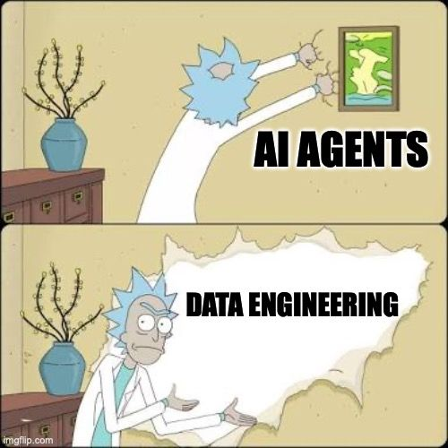

```{=html}
<style>
.smaller { font-size: 85%; }
.tiny    { font-size: 70%; }
</style>
```

```{r load_packages, message=FALSE, warning=FALSE, include=FALSE}
library(fontawesome)
library(knitr)
```

# Sobre el docente

# Enlaces

- `r fa("message", fill = "steelblue")` sebastian.egana\@udd.cl
- `r fa("computer", fill = "steelblue")` <https://segana.netlify.app>
- `r fa("linkedin", fill = "steelblue")` <https://www.linkedin.com/in/sebastian-egana-santibanez/>
- `r fa("github", fill = "steelblue")` <https://github.com/sebaegana>

------------------------------------------------------------------------

## Descripción General

Este módulo capacita para comprender el valor estratégico de los datos, identificar riesgos ocultos y tomar decisiones informadas sobre proyectos de IA.

Sin requerir programación, aprenderán a hacer **preguntas críticas** dentro de sus equipos y a gobernar responsablemente iniciativas de IA.

------------------------------------------------------------------------

## Objetivos de Aprendizaje

Al finalizar esta sesión podrán:

1.  Entender por qué los datos son el **cimiento crítico** de la IA
2.  Identificar los **4 enemigos silenciosos** de los datos
3.  Reconocer **riesgos específicos** en sus industrias
4.  Formular las **5 preguntas clave** antes de implementar IA
5.  Diseñar un proceso básico de **auditoría de datos**

------------------------------------------------------------------------

## Estructura de la Sesión

::: smaller
| Bloque | Duración    | Contenido                                          |
|--------|-------------|----------------------------------------------------|
| **1**  | 50 + 10 min | El combustible de la IA: datos como diferenciador  |
| **2**  | 50 + 10 min | Los enemigos silenciosos: sesgos, calidad, leakage |
| **3**  | 50 + 15 min | Gobernanza y toma de decisiones informadas         |
:::

------------------------------------------------------------------------

# Bloque 1: El Combustible de la IA

------------------------------------------------------------------------

## Cómo la Calidad Vence a la Cantidad

**Lo que la mayoría piensa:**

- IA es magia / inteligencia artificial
- Con suficientes datos, la IA funciona

**La realidad:**

- IA es **estadística + patrones en datos**
- **Calidad de datos \> cantidad de datos**
- 1.000 datos buenos **siempre** vencen a 1.000.000 de datos ruidosos
- Los datos son el combustible; el modelo es el motor
- El modelo es tan bueno como el dato más deficiente en tu dataset

------------------------------------------------------------------------

## El Triángulo de Oro de la IA

```{mermaid}
%%| fig-align: center
graph TD
    D["🎯 DECISIONES<br/>(Output)"]
    M["⚙️ MODELO<br/>(Algoritmo)<br/><i>5% del éxito</i>"]
    DA["🗄️ DATA<br/>(Combustible)<br/><i>95% del éxito</i>"]

    M --> D
    DA --> D
    DA --> M
```

------------------------------------------------------------------------

## La Fórmula: 3 Escenarios

::: smaller
| Escenario | Resultado | ¿Por qué? |
|-----------|-----------|-----------|
| **Datos buenos** + features relevantes + modelo simple | **✓ Éxito** | El modelo aprende patrones reales |
| **Datos malos** + features complicadas + modelo sofisticado | **✗ Fracaso** | El modelo memoriza ruido, no patrones |
| **Datos promedio** + algoritmo avanzado (no compensan) | **✗ Fracaso** | Ningún algoritmo arregla datos pobres |
:::

> *Puedes tener el algoritmo más avanzado del mundo. Si los datos son malos, el resultado será malo. La sofisticación no reemplaza la calidad.*

------------------------------------------------------------------------

## Datos Contextuales > Volumen de Datos

::: smaller
Tres gigantes de streaming, tres estrategias:

| Plataforma | Datos que Capturan | Calidad | Resultado |
|------------|------------------|---------|-----------|
| **Netflix** | Rating, tiempo visto, país, horario | Etiquetado limpio (5⭐, "visto completo") | Recomendaciones precisas |
| **YouTube** | Billones de vistas (pero datos demográficos limitados) | Ruidoso (clickbait, clicks accidentales) | Recomendaciones genéricas |
| **Spotify** | Qué escuchas (6 AM vs 10 PM), repeats, saltos, contexto | Implícito (comportamiento real) | Recomendaciones contextuales exactas |

**Lección:**
- Netflix: *menos datos, mejor calidad* → gana
- YouTube: *más datos, pero ruidosos* → pierde
- Spotify: *datos contextuales únicos* → domina

**Primer insight:** *Éxito en IA = elegir los datos correctos, no acumular TODOS los datos.*
:::

------------------------------------------------------------------------

## Las 3 Preguntas de Ventaja Competitiva

> **¿Qué datos tenemos que nuestros competidores NO tienen?**

1. **¿Qué datos capturamos que otros no?** ← Eso es tu ventaja
2. **¿Esos datos son limpios y confiables?** ← Sino, no son ventaja
3. **¿Esos datos seguirán siendo únicos o se commoditizarán?** ← ¿Cuánto tiempo tenemos?

**Verdad incómoda:** No es el algoritmo. Todos usan los mismos (TensorFlow, Scikit-learn, etc.).

**Tu diferenciador:** Qué datos únicos capturas de tu negocio, cómo los limpias, y cómo los usas antes que compiten.

------------------------------------------------------------------------

## ⚠️ Pero Hay 4 Enemigos Silenciosos

Antes de celebrar tus datos únicos, ten cuidado:

::: smaller
| Enemigo | Riesgo | Impacto |
|---------|--------|--------|
| **Sesgo de Representación** | ¿Hay grupos NO representados en tu data? | El modelo falla para ese grupo |
| **Sesgo Histórico** | ¿Tus históricos reflejan injusticia del pasado? | Perpetúas discriminación a escala |
| **Data Leakage** | ¿Hay información futura "filtrada" en entrenamiento? | KPI falso en pruebas; falla en producción |
| **Calidad de Datos** | ¿Datos incompletos, incorrectos, viejos? | Decisiones inconsistentes |
:::

**Tema del Bloque 2:** Cómo detectar y evitar estos enemigos.

------------------------------------------------------------------------

## `r fa("users", fill = "steelblue")` Actividad 1 — Diagnóstico de Datos (15 min)

::: tiny
Piensa en tu área/empresa y responde:

**1. ¿Qué datos generamos hoy que nunca capturamos?**
- Retail: captura punto de venta, pero NO el momento en que el cliente decide NO comprar
- HR: captura performance review, pero NO conversaciones 1:1 informales

**2. ¿Qué datos tenemos que podrían revelar algo escondido?**
- Bancos: historial de transacciones → ¿cuándo alguien está en riesgo financiero?
- Logística: rutas → ¿cuándo el costo de entrega será más alto?

**3. ¿Quién en nuestra organización NO está representado en nuestros datos?** ← *Sesgo de Representación*
- ¿Solo clientes que compraron? ¿No los que visitaron y no compraron?
- ¿Solo empleados en sede? ¿No remotos?

**4. NUEVO — ¿Cuál de estos datos podría traer los 4 enemigos?**
- De tus respuestas 1-3, ¿cuáles podrían tener: sesgo histórico, data leakage, o problemas de calidad?
:::

------------------------------------------------------------------------

{fig-align="center"}

------------------------------------------------------------------------

# Bloque 2: Los Enemigos Silenciosos

------------------------------------------------------------------------

## Los 4 Enemigos

::: tiny
| Enemigo | Causa | Red Flag |
|-------------------------|--------------------|----------------------------|
| **Representación** | Falta un grupo demográfico | "Funciona bien para el cliente típico" |
| **Histórico** | Datos reflejan prejuicios del pasado | "Reflejaría cómo siempre lo hemos hecho" |
| **Leakage** | Información futura en datos de entrenamiento | "99% de precisión" (sospechosamente alto) |
| **Calidad** | Datos incompletos, incorrectos o viejos | "Nuestros datos están desordenados" |
:::

------------------------------------------------------------------------

## Enemigo #1: Sesgo de Representación

**Definición:** Tu dataset **no representa** a toda la población que afectará la IA.

------------------------------------------------------------------------

## Caso Real: Reconocimiento Facial

**Problema descubierto (2018):**

- Google, Amazon, Microsoft: **tasa de error del 34% en rostros de mujeres oscuras**
- Tasa de error del 0.7% en rostros de hombres blancos

**¿Por qué?** Los modelos se entrenaron mayormente con datos de personas blancas.

------------------------------------------------------------------------

## Caso Real: Reconocimiento Facial (Impacto)

**Impacto:**

- Policía usa algoritmo para identificar sospechosos → falla en comunidades afrodescendientes
- Acceso a edificios por facial → gente con piel oscura queda afuera

------------------------------------------------------------------------

## Caso Real: Modelos de Crédito

**Problema:**

- Banco entrena algoritmo con datos históricos de clientes de clase media-alta
- Algoritmo rechaza más personas de clase baja, aunque sean buen riesgo crediticio

**Razón:** no hay suficientes datos de ese grupo en el histórico

------------------------------------------------------------------------

## Caso Real: Modelos de Crédito (Impacto)

**Impacto:**

- Discriminación indirecta pero efectiva
- Mercado perdido (no alcanzas segmentos nuevos)
- Regulatorio: Regulador podría penalizar (CMF)

------------------------------------------------------------------------

## Cómo Identificar el Sesgo de Representación

**Red flags:**

- "Nuestro modelo funciona bien para el cliente típico"
- "Estos grupos son muy pequeños en nuestros datos"
- "Hay outliers raros que el modelo rechaza"

::: tiny
**Test simple:**

1.  Segmenta tu dataset por: género, edad, geografía, nivel socioeconómico
2.  ¿El modelo funciona **bien** en **todos** los segmentos?
3.  Si no → **hay sesgo de representación**
:::

------------------------------------------------------------------------

## Enemigo #2: Sesgo Histórico

**Definición:** Entrenas un modelo con datos del pasado que reflejan injusticias del pasado. El modelo las **perpetúa**.

------------------------------------------------------------------------

## Caso Real: Amazon Hiring Algorithm (2014–2018)

**¿Qué pasó?**

- Amazon creó un algoritmo para filtrar CVs automáticamente
- Lo entrenó con 10 años de contrataciones históricas en tech
- **Problema:** históricamente contrataban más hombres en tech - **Resultado:** el algoritmo aprendió a rechazar mujeres

------------------------------------------------------------------------

## Caso Real: Amazon Hiring Algorithm (Detalles)

**Detalles perturbadores:**

- Rechazaba palabras como *"women's chess club"*
- Rechazaba CVs de egresadas de colegios para mujeres

**Amazon mató el proyecto en 2018.** No por altruismo: costoso en reputación y legal.

------------------------------------------------------------------------

## Caso Real: Sistema de Justicia Criminal

**¿Qué pasó?**

- Policía usa el algoritmo COMPAS para predecir reincidencia
- Entrenado con datos históricos de quién fue detenido antes
- **Problema:** el sistema penal históricamente sobre-arresta a gente negra
- **Resultado:** el algoritmo predice más reincidencia en gente negra (lógica circular)

------------------------------------------------------------------------

## Caso Real: Sistema de Justicia Criminal (Preguntas)

**Preguntas sin respuesta:**

- ¿Fue reincidencia… o simplemente los arrestaron otra vez?
- ¿El algoritmo predice crimen o predice quién será arrestado?

------------------------------------------------------------------------

## Cómo Identificar el Sesgo Histórico

**Red flags:**

- "Nuestro modelo refleja lo que siempre hemos hecho"
- "Usamos datos históricos de evaluaciones / contrataciones / decisiones"
- "El modelo mantiene el status quo"

::: smaller
**Test:**

1.  ¿Tus datos vienen de decisiones humanas del pasado?
2.  ¿Esas decisiones eran justas / objetivas?
3.  Si la respuesta no es un "sí" claro → **hay sesgo histórico**
:::

------------------------------------------------------------------------

## Enemigo #3: Data Leakage

**Definición:** El modelo usa información que **no tendría disponible** en producción real. Parece perfecto en pruebas; falla en la realidad.

------------------------------------------------------------------------

## Caso Real: Predicción de Fraude

```{=html}
<pre style="font-size:0.72em; line-height:1.5;">
Datos de entrenamiento incluyen:
  - Monto de transacción
  - País
  - Hora
  - ¿FUE REPORTADO COMO FRAUDE? ← ✗ ERROR

El modelo aprende: "si fue reportado, es fraude"
KPI en test: 99% de precisión ✓ (falso)

En producción:
  - Cliente realiza transacción
  - Necesitamos predecir AHORA si es fraude
  - Pero "si fue reportado" solo se sabe DESPUÉS
  - Resultado: modelo rechaza transacciones legítimas
</pre>
```

------------------------------------------------------------------------

## Caso Real: Predicción de Mortalidad Hospitalaria

```{=html}
<pre style="font-size:0.72em; line-height:1.5;">
Variables incluidas:
  - Edad, síntomas, historial médico
  - ¿TUVO CUIDADOS INTENSIVOS? ← ✗ ERROR

Modelo predice: "pacientes en ICU mueren más"
Conclusión: "invertir menos en ICU reduce muertes"

Realidad: la ICU es lo que SALVA a pacientes críticos.
El modelo confundió causación con correlación.
</pre>
```

------------------------------------------------------------------------

## Data Leakage: Predicción de Deserción Escolar

**Lo que FUNCIONA:**

- Datos de hace 2 meses: asistencia, notas, engagement
- Predecir: ¿desertor en próximos 3 meses?

::: smaller
**Lo que NO funciona:**

- Incluir: *"¿Se retiró del colegio?"* — ¡eso es exactamente lo que predices!
- Resultado: 100% de precisión, modelo completamente inútil

> **Si el KPI es demasiado bueno (\>95%), busca leakage.**
:::

------------------------------------------------------------------------

## Cómo Detectar Data Leakage

**Pregunta clave:**

\> *"¿Toda la información del modelo estaría disponible en el momento exacto en que necesitamos predecir?"*

**Red flags:**

- KPI de precisión \> 99% (sospechosamente perfecto)
- El outcome (lo que predices) aparece como variable en el modelo
- Datos que solo existen **después** del evento que predices

------------------------------------------------------------------------

## Enemigo #4: Calidad de Datos

**Definición:** Datos incompletos, incorrectos, contradictorios o desactualizados.

::: tiny
| Problema | Ejemplo | Impacto |
|---------------------------|------------------------|----------------------|
| **Incompletos** | 30% de edad faltante en CRM | El modelo rechaza registros o asume mal |
| **Incorrectos** | Cliente registrado 2 veces con edades distintas | Inconsistencia en decisiones |
| **Desactualizados** | Dirección de cliente de 2015 | Marketing envía a dirección incorrecta |
:::

------------------------------------------------------------------------

## Enemigo #4: Calidad de Datos (cont.)

::: smaller
| Problema | Ejemplo | Impacto |
|---------------------------|------------------------|----------------------|
| **Contradictorios** | "Estado: activo" pero "fecha baja: 2020" | Confusión en la lógica de negocio |
| **Sesgados en entrada** | Solo se registran clientes que compraron | El modelo no ve quién NO compra |
:::

------------------------------------------------------------------------

## La Realidad Incómoda

> **El 80% del tiempo en un proyecto de IA es limpieza de datos.**

No es atractivo. No es "IA". Pero es **crítico**.

::: smaller
**Test simple de calidad:**

1.  Toma 100 registros aleatorios
2.  Valídalos manualmente: ¿son correctos?
3.  Si \< 95% correcto → **hay problema de calidad**
:::

------------------------------------------------------------------------

## Resumen: Los 4 Enemigos

::: tiny
| Enemigo | Causa | Impacto | Red Flag |
|------------------|------------------|------------------|-------------------|
| **Representación** | Falta un grupo demográfico | Modelo falla para ese grupo | "Funciona bien para el cliente típico" |
| **Histórico** | Datos reflejan prejuicios del pasado | Perpetúa injusticia a escala | "Refleja cómo siempre lo hicimos" |
| **Leakage** | Información futura en entrenamiento | KPI falso; falla en producción | "99% de precisión" |
| **Calidad** | Datos incompletos, incorrectos o viejos | Decisiones inconsistentes | "Nuestros datos están desordenados" |
:::

------------------------------------------------------------------------

## Síntesis Integrada: Cómo los Enemigos Interactúan

**Verdad incómoda:** Un proyecto de IA raramente tiene UN solo enemigo. Usualmente hay MÚLTIPLES simultáneamente.

::: smaller
**Escenario típico — Banco de crédito:**
- ❌ Sesgo de Representación: pocos datos de clase baja
- ❌ Sesgo Histórico: evaluaciones pasadas discriminaban a clase baja
- ❌ Calidad: datos de clientes antiguos están desactualizados
- **Resultado:** Algoritmo rechaza nuevos segmentos injustamente

**Escenario típico — Sistema de justicia criminal:**
- ❌ Sesgo Histórico: arrestos históricos sobre-representan minorías
- ❌ Sesgo de Representación: datos de quién fue arrestado (no de quién cometió crimen)
- **Resultado:** Lógica circular — el algoritmo perpetúa discriminación policial

**Pregunta clave para líderes:**
> *"¿Hemos identificado TODOS los enemigos en este dataset, o solo el obvio?"*
:::

------------------------------------------------------------------------

## Desglose por Industria: Cuál Enemigo es Crítico en Tu Sector

::: smaller
| Sector | Enemigos Críticos | Riesgo Específico | Acción Inmediata |
|--------|---|---|---|
| **Fintech / Crédito** | Data Leakage, Histórico | Rechazar injustamente nuevos segmentos | Auditar variables de entrenamiento |
| **HR / Contratación** | Histórico, Representación | Perpetuar discriminación en contratación | Recolectar datos diversos (nuevo grupos) |
| **Healthcare** | Calidad, Leakage | Decisiones médicas en datos incompletos | Validar completitud (\>95%) |
| **Justicia Criminal** | Histórico, Representación | Lógica circular (arresto = reincidencia) | No usar este dato (está corrupto) |
| **Retail / Recomendaciones** | Representación, Calidad | Sesgos culturales en recomendaciones | Test con clientes de diferentes perfiles |
:::

------------------------------------------------------------------------

# Bloque 3: Gobernanza y Toma de Decisiones

------------------------------------------------------------------------

## Las 5 Preguntas que Todo Líder Debe Hacer

**Antes de aprobar cualquier proyecto de IA, formula estas preguntas.** Cada pregunta mapea a un enemigo específico:

::: smaller
| # | Pregunta | Mapea a Enemigo | Objetivo |
|---|----------|---|---|
| 1️⃣ | ¿Quién está representado en estos datos? | **Sesgo de Representación** | Identificar grupos sub-representados |
| 2️⃣ | ¿Estos datos reflejan decisiones justas del pasado? | **Sesgo Histórico** | Auditar si perpetúamos injusticia |
| 3️⃣ | ¿Hay información aquí que no tendríamos al momento de decidir? | **Data Leakage** | Detectar información futura "filtrada" |
| 4️⃣ | ¿Qué tan limpia y confiable es esta data? | **Calidad de Datos** | Validar integridad antes de usar |
| 5️⃣ | ¿Cómo sabemos si el modelo falla? ¿Quién lo vigila? | **Gobernanza Continua** | Evitar que problemas pasen desapercibidos |
:::

**Ahora aprenderás cómo hacer cada pregunta con confianza, incluso si el equipo técnico es evasivo.**

------------------------------------------------------------------------

## Pregunta 1: ¿Quién está representado?

::: tiny
**Por qué:** identificar sesgos de representación.

**Cómo preguntar:** - "¿Todos nuestros clientes / empleados están en estos datos?" - "¿Hay grupos que falten? ¿Qué pasará con ellos?"

**Señales de respuesta:** - `r fa("check", fill = "green")` "80% de nuestros clientes activos, distribuidos así..." - `r fa("xmark", fill = "red")` "Suficientes datos" - `r fa("xmark", fill = "red")` "No es importante"

**Acción si hay riesgo:** - Recolectar datos del grupo faltante - Limitar el scope: "este modelo es solo para clientes premium" - Monitorear sesgo por segmento
:::

------------------------------------------------------------------------

## Pregunta 2: ¿Los históricos fueron justos?

::: tiny
**Por qué:** identificar sesgo histórico que perpetúa injusticia.

**Cómo preguntar:** - "¿De dónde vienen estos datos históricos?" - "¿Las decisiones del pasado fueron justas? ¿O reflejan cómo discriminábamos?"

**Señales de respuesta:** - `r fa("check", fill = "green")` "Datos de decisiones que auditamos y validamos" - `r fa("xmark", fill = "red")` "Datos de cómo siempre lo hemos hecho" - `r fa("xmark", fill = "red")` "Asumimos que el histórico es objetivo"

**Acción si hay riesgo:** - Auditar las decisiones históricas - Limpiar datos discriminatorios - Limitar el impacto: recomendación (no decisión automática)
:::

------------------------------------------------------------------------

## Pregunta 3: ¿Hay data leakage?

::: tiny
**Por qué:** detectar información futura infiltrada en el entrenamiento.

**Cómo preguntar:** - "¿Cuándo predecimos esto exactamente?" - "¿Toda esta información estaría disponible EN ESE MOMENTO?"

**Ejemplo de conversación:**

*Tú:* "¿Incluyen la variable 'fue reportado como fraude' en entrenamiento?"

*Técnico:* "Sí."

*Tú:* "¿En producción, cuando necesitamos predecir, ya sabremos eso?"

*Técnico:* "Ah… no. Eso se sabe después."

*Tú:* **"Saca esa variable. El modelo está truqueado."**
:::

------------------------------------------------------------------------

## Pregunta 4: ¿Qué tan limpia es la data?

::: tiny
**Por qué:** calidad de datos = confiabilidad de las decisiones.

**Cómo preguntar:** - "¿Cuánto tiempo se invirtió en limpieza?" - "¿Qué porcentaje está incompleto? ¿Qué tan actualizado está?"

**Señales de respuesta:** - `r fa("check", fill = "green")` "80% del tiempo fue limpieza. Datos 95%+ correctos. Revisión mensual." - `r fa("xmark", fill = "red")` "Usamos datos como están. Probablemente esté bien."

**Benchmark:**

| Proyecto   | \% tiempo en limpieza |
|------------|-----------------------|
| Pequeño    | \~50%                 |
| Grande     | \~80%                 |
| Sospechoso | \<30%                 |
:::

------------------------------------------------------------------------

## Pregunta 5: ¿Quién vigila el modelo?

::: tiny
**Por qué:** datos y modelos cambian; el sesgo puede aparecer con el tiempo.

**Cómo preguntar:** - "¿Cómo monitorean el desempeño en el mundo real?" - "¿Quién es responsable si falla?" - "¿Qué pasaría si el modelo empieza a favorecer a un grupo?"

**Señales de respuesta:** - `r fa("check", fill = "green")` "Dashboard mensual. Métricas por segmento demográfico. Alertas automáticas." - `r fa("xmark", fill = "red")` "Asumimos que funciona igual que en el test." - `r fa("xmark", fill = "red")` "No lo hemos pensado."

**Acción si hay riesgo:** - Establecer SLAs y alertas - Plan de rollback (cómo parar rápido si falla) - Auditoría trimestral
:::

------------------------------------------------------------------------

## Cómo Hacer Preguntas Incómodas: Cuando el Equipo es Evasivo

**Si el equipo dice esto →** Respuesta sospechosa (presión incómoda)

::: tiny
| Si escuchas... | Es señal de... | Pregunta de profundización |
|---|---|---|
| "Suficientes datos" (sin detallar) | No han auditado representación | "¿Cuánto es 'suficiente'? Muéstrenme por segmento" |
| "El modelo funciona bien" (sin contexto) | Pueden estar escondiendo sesgo | "¿Bien para QUIÉNES? ¿Y para grupos minoritarios?" |
| "Es complicado" o "No es importante" | Evasión deliberada | "Entiendo que es complicado. Expliquenme cómo lo resolvieron" |
| "Asumimos que está limpio" | NO lo auditaron | "¿Cuántas horas invirtieron en limpieza? ¿Menos de 20 horas?" |
| "Usamos datos históricos" (sin validación) | Sesgo histórico probable | "¿Auditaron que esas decisiones históricas fueron justas?" |
| "99% de precisión" o "100% de precisión" | Data leakage casi garantizado | "¿Revisaron que no hay información futura en el entrenamiento?" |
| "No lo hemos pensado" (sobre monitoreo) | No hay gobernanza | "Entonces no está listo. Párelo hasta que lo hayan pensado" |
:::

**Tu rol:** No necesitas entender la respuesta técnica. Necesitas ver si **están evadiendo** o **siendo transparentes**.
:::

------------------------------------------------------------------------

## Marco de Decisión Final: ¿Apruebo Este Proyecto?

::: tiny
| # | Pregunta | ✓ Aprueba | ✗ Detener | ⚠️ Riesgo → Acción |
|---|---|---|---|---|
| 1️⃣ | ¿Representación? Todos grupos presentes | Distribuido equitativamente | Falta grupo importante | Sub-representado → Recolectar datos O limitar scope |
| 2️⃣ | ¿Históricos justos? Auditados | Auditoría completa | Nunca auditado | Perpetúa injusticia → Auditar y limpiar ANTES |
| 3️⃣ | ¿Sin data leakage? Variables validadas | Todas disponibles EN DECISIÓN | Hay información futura | KPI falso → Remover variables futuras |
| 4️⃣ | ¿Calidad? Datos validados | \>95% correcto | \<95% correcto | Inconsistencia → Invertir en limpieza |
| 5️⃣ | ¿Monitoreo? Plan de vigilancia | Dashboard + alertas | Sin plan | Sorpresas → Implementar ANTES |
:::

::: smaller
**Criterio final:**
- **5/5 "Aprueba"** → Adelante sin restricciones
- **4/5 "Aprueba" + 1 "Riesgo" (con plan)** → Adelante con plan de remediación
- **Cualquier "Detener"** → **No aprueba hasta resolverlo**

**Tiempo típico:** Remediación toma 2-6 semanas. Es invertible pero necesario.
:::

------------------------------------------------------------------------

## El Rol del Líder en Gobernanza de Datos

::: smaller
No tienes que ser técnico. Pero tienes que:

1.  **Hacer preguntas incómodas** — sin miedo a parecer ignorante
2.  **Entender los riesgos** — sesgos, leakage, calidad
3.  **Establecer estándares** — auditoría, monitoreo, responsabilidad
4.  **Actuar si hay problemas** — parar, revisar, remediar

> **Si un modelo falla y afecta a clientes o empleados, tú eres responsable.**
:::

------------------------------------------------------------------------

## `r fa("terminal", fill = "steelblue")` Actividad 2 — Auditoría con IA (15 min)

::: tiny
- Trabajen en grupo con uno de los 2 casos del handout: Fintech (créditos automáticos) o Manufactura (mantenimiento predictivo)
- Parte 1: evalúen el proyecto ustedes mismos con los 4 Enemigos Silenciosos, **sin IA**
- Parte 2: auditen el mismo escenario con un LLM (`vibe`, el CLI oficial de Mistral, o <https://chat.mistral.ai>), usando el prompt-framework del handout
- Comparen: ¿la IA detectó lo mismo que ustedes? ¿qué se le pasó?

> **Handout completo (escenario, tablas, prompt y debrief):** `202607_actividad02_skill-auditoria-datos.pdf`
:::

::: notes
Preparación previa (no mostrar en pantalla): instalar y probar `vibe` con el prompt del handout antes de la clase. Backup si `vibe` falla en vivo: usar `auditar_mistral.ps1` (`. .\clases\scripts\auditar_mistral.ps1` y `auditar "..."`) o directamente chat.mistral.ai. Repartir el handout `202607_actividad02_skill-auditoria-datos.pdf` antes de comenzar la actividad.
:::

------------------------------------------------------------------------

## Monitoreo Mensual: Mantén la Vigilancia

::: smaller
**Cada mes, el equipo técnico debe reportar:**

```
□ ¿Métricas de desempeño igual que hace 30 días?
□ ¿Cambios en el desempeño POR SEGMENTO demográfico?
□ ¿Alertas de anomalías? ¿Cuáles?
□ ¿Data cambió? ¿Cómo impactó el modelo?
□ ¿Feedback de usuarios sobre errores/sesgos?
□ ¿Necesita reentrenamiento?
□ ¿Algo sorprendente?
```

**Tú como líder debes preguntar:**
- "¿Ves degradación en algún segmento?"
- "¿Algo sorprendente este mes?"
- "¿Si algo malo pasara, en cuánto tiempo nos enteraríamos?"

**Alerta roja:** Si dicen "todo funciona igual" sin mostrar números por segmento → no están monitoreando realmente.
:::

------------------------------------------------------------------------

## Cierre: La Responsabilidad del Líder

> **"Datos es poder. El poder requiere responsabilidad."**

::: smaller
No necesitas ser Data Scientist para liderar con integridad. Necesitas:

- **Curiosidad** — hacer preguntas
- **Escepticismo sano** — dudar de resultados perfectos
- **Empatía** — pensar en quién se ve afectado
- **Coraje** — parar un proyecto si tiene riesgo

**El 80% de los fracasos en IA no son por tecnología. Son por datos malos, sesgos ocultos y líderes que no hicieron preguntas.**
:::

------------------------------------------------------------------------

# Anexo

------------------------------------------------------------------------

## Glosario para Líderes

| Término          | Definición simple                                        |
|--------------------------|----------------------------------------------|
| **Dataset**      | Tabla con filas (ejemplos) y columnas (datos)            |
| **Sesgo**        | El modelo favorece o rechaza a un grupo sin razón válida |
| **Data Leakage** | Información futura "filtrada" en datos de entrenamiento  |

------------------------------------------------------------------------

## Glosario para Líderes (cont.)

| Término | Definición simple |
|--------------------------|----------------------------------------------|
| **Overfitting** | Modelo que memoriza en lugar de aprender patrones generalizables |
| **Feature** | Una columna de datos: edad, ubicación, historial de compras |
| **Entrenamiento** | Proceso donde el modelo aprende patrones desde los datos |

------------------------------------------------------------------------

## Glosario para Líderes

| Término | Definición simple |
|--------------------------|----------------------------------------------|
| **Validación** | Testear el modelo en datos nuevos (no usados en entrenamiento) |
| **Producción** | El modelo en uso real, haciendo predicciones |
| **KPI** | Métrica de desempeño (ej. "precisión 95%") |
| **Monitoreo** | Vigilar que el modelo siga funcionando correctamente |

------------------------------------------------------------------------

## Lecturas Recomendadas

- **Weapons of Math Destruction** — Cathy O'Neil *(accesible, crítico)*
- **Fairness and Machine Learning** — Barocas, Hardt & Narayanan *(más técnico pero abordable)*

::: smaller
**Casos de estudio:**

- Amazon Hiring Algorithm (2018) — sesgo histórico en contratación
- COMPAS (justicia criminal) — sesgo histórico en sistema penal
- Gender Shades — Buolamwini & Gebru (MIT, 2018) — sesgo de representación en reconocimiento facial
:::

------------------------------------------------------------------------

# Referencias

::: tiny
Buolamwini, J., & Gebru, T. (2018). Gender shades: Intersectional accuracy disparities in commercial gender classification. *Proceedings of the 1st Conference on Fairness, Accountability and Transparency*, 77–91. <http://proceedings.mlr.press/v81/buolamwini18a.html>

Barocas, S., Hardt, M., & Narayanan, A. (2023). *Fairness and Machine Learning: Limitations and Opportunities*. MIT Press. <https://fairmlbook.org>

O'Neil, C. (2016). *Weapons of Math Destruction: How Big Data Increases Inequality and Threatens Democracy*. Crown Publishers.

Angwin, J., Larson, J., Mattu, S., & Kirchner, L. (2016). Machine bias. *ProPublica*. <https://www.propublica.org/article/machine-bias-risk-assessments-in-criminal-sentencing>

Dastin, J. (2018). Amazon scraps secret AI recruiting tool that showed bias against women. *Reuters*. <https://www.reuters.com/article/us-amazon-com-jobs-automation-insight-idUSKCN1MK08G>
:::